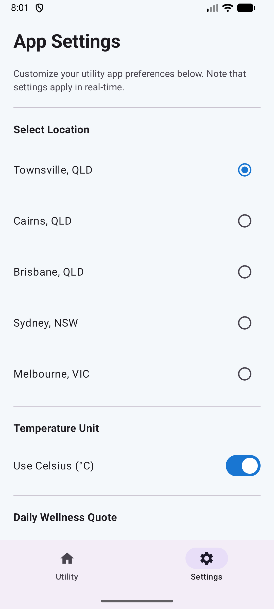
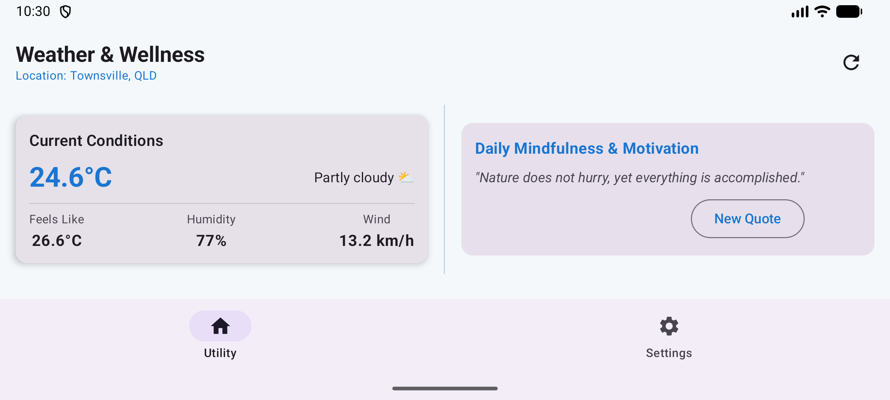

# Weather & Wellness

**Student Name:** Mohammed Khan  
**App Name:** Weather & Wellness (`au.edu.jcu.assessment.utilityapp`)

---

## 🌤️ App Overview
**Weather & Wellness** is a feature-rich, modern Android utility application that bridges real-time meteorological data with daily mental well-being. It provides live weather forecasts across major Australian cities (Townsville, Cairns, Brisbane, Sydney, Melbourne) and pairs them with daily inspirational mindfulness quotes.

---

## 🎨 Logo & Theming Consistency
The app's UI theme and color palette (Sky Blue and Sunny Amber) are fully matched to the custom sun-and-clouds adaptive launcher icon, ensuring seamless brand consistency across the app and home screen.

---

## 📱 Core Features & Implementation

1. **Real-Time Weather Forecasting (Retrofit & Open-Meteo API):**
   - Integrates with the public Open-Meteo REST API (`https://api.open-meteo.com/`).
   - Uses **Retrofit 2** with Gson converter and **Kotlin Coroutines** (`suspend`) for asynchronous, non-blocking network requests.
   - Displays temperature (`°C`/`°F`), apparent temperature ("feels like"), humidity, wind speed, and dynamic weather condition descriptions.

2. **City Selection & Settings (Jetpack ViewModel & State):**
   - Allows users to seamlessly switch between multiple Australian cities.
   - Provides a settings toggle to switch temperature units and show/hide daily wellness quotes.
   - State is managed reactively via Jetpack `ViewModel`, `viewModelScope`, and Compose `mutableStateOf`, ensuring configuration changes (like screen rotation) are handled seamlessly.

3. **Daily Mindfulness & Motivation:**
   - Features curated inspirational quotes designed to promote mental wellness.
   - Includes a refresh button to cycle through daily quotes.

4. **Responsive Portrait & Landscape Views:**
   - **Portrait Mode:** Clean, non-scrollable vertical layout with cards weighted to fill available screen height perfectly.
   - **Landscape Mode:** Non-scrollable two-pane side-by-side layout showing both weather and motivation quote simultaneously, separated by a distinct vertical border line.

5. **Material 3 Design & Professional Sub-Packages:**
   - Built entirely with **Jetpack Compose Material 3**.
   - Organized into professional sub-packages (`data`, `ui.viewmodel`, `ui.screen`, `ui.components`, `ui.theme`).

---

## 🖼️ Application Screenshots

### 1. Main Dashboard Screen (Portrait)

### 2. Settings Preferences Screen

### 3. Landscape Two-Pane View (Side-by-Side with Border Line)

---

## 🛠️ Architecture & Tech Stack
- **Language:** Kotlin 2.0+
- **UI Toolkit:** Jetpack Compose (Material 3)
- **Architecture Pattern:** MVVM (Model-View-ViewModel)
- **Networking:** Retrofit 2, Gson, OkHttp
- **Asynchronous Programming:** Kotlin Coroutines & Flow
- **Minimum SDK:** API 26 (Android 8.0+)
- **Target/Compile SDK:** API 36

---

## 🚀 Getting Started

1. Clone or download this repository.
2. Open the project in **Android Studio**.
3. Ensure you have internet connection enabled (the app requires the `INTERNET` permission to fetch live weather data).
4. Run the app on an Android emulator or physical device (API 26+).

---

## 📚 License
Developed for educational assessment in Mobile Technologies.
